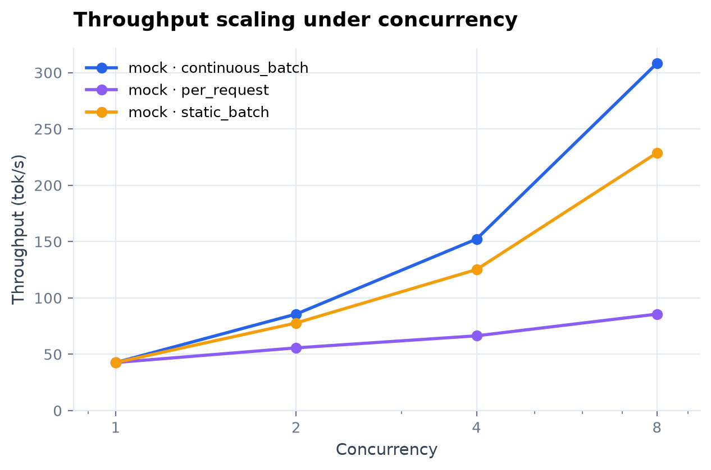
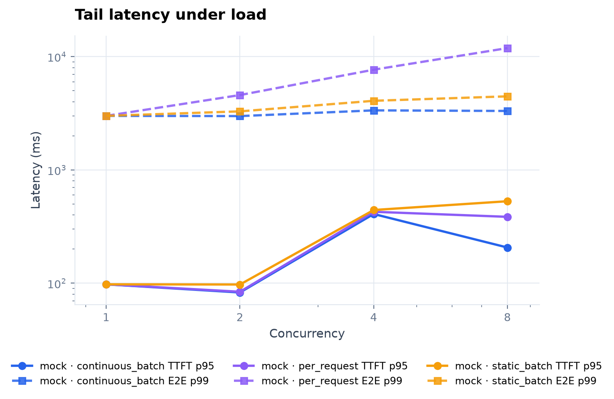
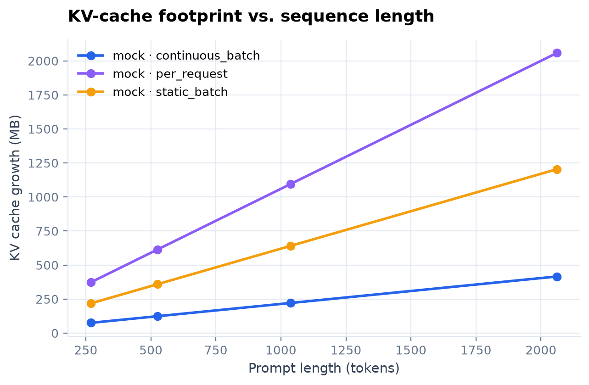
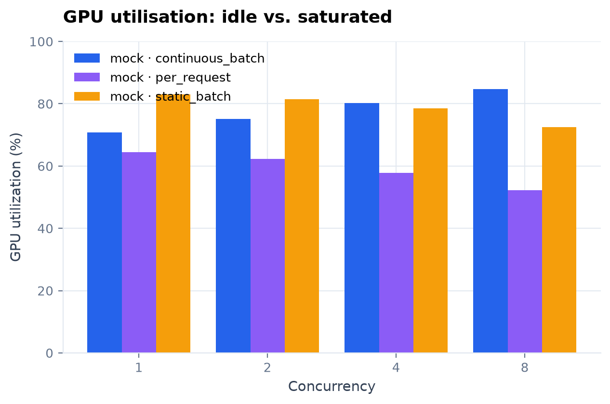
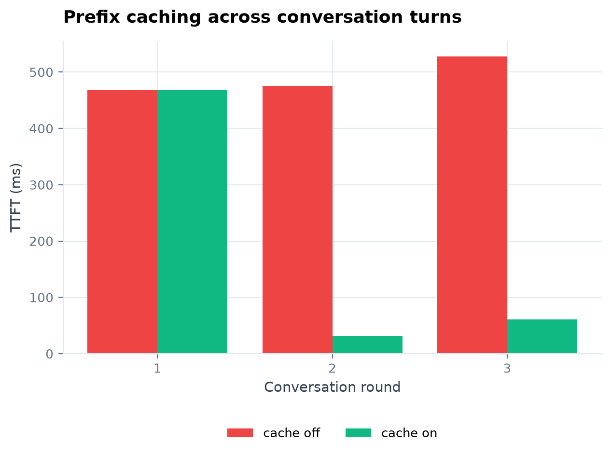
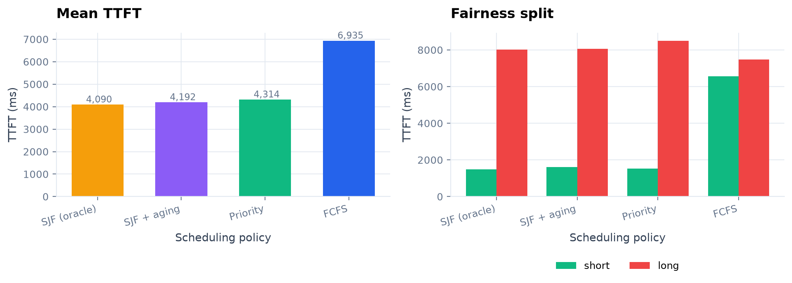

# LLM Inference Benchmark

**一套可复现、可审计、开箱即用的 LLM 推理性能基准测试框架。**
对比 vLLM 与 HuggingFace Transformers 在 Continuous Batching、PagedAttention、
Prefix Caching、KV Cache 管理与调度策略上的真实差异。

[](.github/workflows/ci.yml)
[](pyproject.toml)
[](LICENSE)
[](src/llmbench/dashboard/app.py)

```bash
git clone https://github.com/tochikoma777/llm-inference-benchmark
cd llm-inference-benchmark
python -m venv .venv && source .venv/bin/activate
pip install -e ".[viz]"
llmbench run -c config/smoke.yaml && llmbench report --latest --open
```

没有 GPU？上面这条命令照样能跑通 —— 内置的**解析式模拟后端**会在几秒内生成一整套
结果、图表和可交互报告，用来验证流水线与演示结论。

> **当前验证状态**：整条流水线已用模拟后端完成端到端验证；真实 vLLM / HuggingFace
> 代码路径已实现并做了版本回退，但**尚未在 24GB GPU 上跑过**。
> 验收清单见 [docs/roadmap.md](docs/roadmap.md#3-gpu-验收清单)。
> 引用任何数字前，请先确认对应 run 的 `metadata.json` 中 `system.mock` 的值。

---

## 目录

- [为什么值得一看](#为什么值得一看)
- [核心结论](#核心结论)
- [快速开始](#快速开始)
- [命令一览](#命令一览)
- [基准测试场景](#基准测试场景)
- [结果与图表](#结果与图表)
- [配置](#配置)
- [项目结构](#项目结构)
- [如何接入新的推理后端](#如何接入新的推理后端)
- [测量方法学](#测量方法学)
- [已知限制](#已知限制)
- [文档与可追溯性](#文档与可追溯性)
- [开发](#开发)

---

## 为什么值得一看

大多数推理 benchmark 项目止步于「跑一个脚本、打印一个数字」。这个项目在四件事上做了
不同的取舍：

**1. 测量是真的，不是估算的。**
TTFT 由引擎内部的逐 token 回调测得（HuggingFace 用 `StoppingCriteria`，
vLLM 用流式 `AsyncLLMEngine`），而不是「生成 1 个 token 的总耗时」这种代理指标。
并发吞吐用泊松/恒定到达的真实负载发生器打出，而不是「一次性提交 N 条」。

**2. 结论可审计。**
每一条测量以 JSONL 落盘，附带完整的环境指纹（GPU、驱动、torch/vLLM 版本）和配置快照。
任何一张图都能回溯到原始记录，没有一个数字是手写的。

**3. 没有 GPU 也能跑。**
模拟后端把整条流水线（负载生成 → 遥测 → 聚合 → 图表 → 仪表盘 → 报告）都覆盖到，
CI 里也能跑。所有模拟产物的元数据都标记 `is_mock=true`，报告顶部有醒目横幅，不会
被误当成实测数据。

**4. 交付物是给人看的。**
自包含 HTML 报告（离线可开）+ Streamlit 交互仪表盘 + publication 级 PNG + GitHub
友好的 Markdown，四种形态共用同一套分析代码，不会出现「图和表对不上」。

---

## 核心结论

以下数字来自 `make demo`（**模拟后端**，以 RTX 3090 + Qwen2.5-7B 的实测数据标定）。
真实硬件上的完整实测见 [docs/reference-run-rtx3090.md](docs/reference-run-rtx3090.md)。

| 指标 | HuggingFace<br>per-request | HuggingFace<br>static batch | vLLM<br>continuous batch | 结论 |
|---|---:|---:|---:|---|
| 并发 8 吞吐 | 86 tok/s | 229 tok/s | **308 tok/s** | **3.6×** |
| 并发 8 的 TTFT p95 | 385 ms | 529 ms | **206 ms** | 调度开销更低 |
| 并发 8 的 E2E p99 | 11.9 s | 4.5 s | **3.3 s** | 尾延迟降 72% |
| 2048 token 时 KV 增量 | 2058 MB | 1204 MB | **416 MB** | **省 79.8%** |
| GPU 利用率（c=8） | 52% | 73% | **85%** | 高负载下更稳 |
| 多轮对话 Prefix Cache | — | — | **8.7×** TTFT | 共享前缀复用 |

调度策略模拟器（120 请求、12 并发槽位、FCFS vs SJF vs 优先级 vs 老化 SJF）：

| 策略 | 平均 TTFT | 短请求 TTFT | 长请求 TTFT | 尾延迟 p99 |
|---|---:|---:|---:|---:|
| FCFS | 6.93 s | 6.57 s | 7.48 s | **62.2 s** |
| SJF（已知作业长度） | **4.09 s** | **1.48 s** | 8.01 s | 72.6 s |
| SJF + 老化 | 4.19 s | 1.62 s | 8.05 s | 65.0 s |
| 优先级 | 4.31 s | 1.52 s | 8.50 s | 62.6 s |

> 经典权衡一目了然：SJF 把短请求的首 token 延迟压到 1/4.4，代价是长请求被推迟、
> 尾延迟变差。加老化或改用优先级可以在两者之间取平衡。

---

## 快速开始

### 1. 安装

```bash
python -m venv .venv && source .venv/bin/activate
pip install -e ".[viz,dev]"      # 核心 + 仪表盘 + 开发工具
```

### 2. 先跑演示（无需 GPU）

```bash
make demo        # 三种服务模式各跑一次，再合并出一份对比报告
```

产物：

```
reports/demo/
├── benchmark_report_*.html      # 自包含交互报告（双击即看）
├── benchmark_report.generated.md
└── figures/*.png                # publication 级静态图
```

### 3. 看交互仪表盘

```bash
llmbench dashboard
# 或指定数据目录： llmbench dashboard --results-dir data/results/demo
```

### 4. 在真实 GPU 上跑

```bash
pip install -r requirements-gpu.txt          # torch / transformers / vLLM
llmbench fetch-model --model qwen/Qwen2.5-7B-Instruct
export LLMBENCH_MODEL_PATH=/path/to/Qwen2.5-7B-Instruct

bash scripts/run_gpu.sh "$LLMBENCH_MODEL_PATH"   # HF + vLLM 各跑一遍
llmbench report --all --open                     # 合并成一张对比报告
```

---

## 命令一览

| 命令 | 作用 |
|---|---|
| `llmbench run -c config/vllm.yaml` | 按配置执行基准测试 |
| `llmbench report --latest --open` | 生成 HTML / Markdown / 图表 |
| `llmbench dashboard` | 启动 Streamlit 交互仪表盘 |
| `llmbench sim --policies fcfs sjf priority` | 只跑调度策略模拟器 |
| `llmbench runs` | 列出历史实验 |
| `llmbench show <run-id>` | 打印单次实验的关键指标 |
| `llmbench export --out data.csv` | 导出全部测量为 CSV |
| `llmbench datasets --num 200` | 生成合成 prompt 数据集 |
| `llmbench info` | 打印环境、路径、可用后端 |
| `llmbench clean --older-than 7` | 清理历史实验 |
| `llmbench fetch-model` | 从 ModelScope 下载模型 |

任意配置项都可以用 `--set` 覆盖：

```bash
llmbench run -c config/vllm.yaml \
  --set backend.enable_prefix_caching=true \
  --set scenarios.concurrency_levels=[1,4,16,32] \
  --set workload.arrival.mode=poisson \
  --set workload.arrival.rate_rps=12
```

---

## 基准测试场景

| 场景 | 测量内容 | 关键设计 |
|---|---|---|
| `single` | TTFT / TPOT / 端到端延迟随输入输出长度变化 | 每个组合单独一次请求，真实逐 token 计时 |
| `concurrency` | 吞吐与尾延迟随并发扩展 | 线程池 + 泊松/恒定到达，每请求独立计时 |
| `memory` | 显存峰值与 KV Cache 增量 | 采样基线显存，只统计「生成带来的增量」 |
| `prefix_cache` | 多轮对话的共享前缀复用 | 缓存开/关各起一个引擎，同一份长文档 |
| `scheduler` | FCFS / SJF / 优先级 / 老化 SJF | 离散事件模拟，块级 KV 分配与抢占 |

三种服务模式可对比：

- `per_request` —— 每请求一次前向（最朴素的部署方式）
- `static_batch` —— 补齐到最长序列，一个批次一起进一起出
- `continuous_batch` —— vLLM 式迭代级调度

---

## 结果与图表

### 吞吐扩展与尾延迟




### KV Cache 与 GPU 利用率




### 前缀缓存与调度策略




> 全部图片由 `llmbench report` 从原始 JSONL 生成；`reports/demo/` 下的报告可以直接打开。

---

## 配置

一份 YAML 描述一次实验，`config/` 下提供四个模板：

| 文件 | 用途 |
|---|---|
| `config/default.yaml` | 默认 mock 配置，开箱即用 |
| `config/smoke.yaml` | 一分钟的冒烟测试（CI 使用） |
| `config/vllm.yaml` | 真实 vLLM 引擎 |
| `config/hf.yaml` | HuggingFace 参考实现 |

常用参数：

```yaml
model:
  path: null                 # 或 export LLMBENCH_MODEL_PATH
  dtype: float16
  max_model_len: 8192

backend:
  name: vllm                 # mock | naive | vllm
  serving_mode: continuous_batch   # continuous_batch | static_batch | per_request | offline
  enable_prefix_caching: false
  gpu_memory_utilization: 0.85

workload:
  num_requests: 64
  max_new_tokens: 128
  arrival:
    mode: poisson            # burst | constant | poisson
    rate_rps: 8.0

scenarios:
  concurrency_levels: [1, 2, 4, 8]
  prompt_lengths: [256, 512, 1024, 2048]
  output_lengths: [1, 128, 256]
  repeats: 2
```

配置加载顺序：**dataclass 默认值 → YAML → 环境变量 → `--set` 覆盖**。
写错的键不会静默丢弃，而是进入 `extra` 并可被后端读取（例如
`backend.extra.max_num_batched_tokens`）。

---

## 项目结构

```text
llm-inference-benchmark/
├── config/                     # 实验配置模板
├── src/llmbench/
│   ├── core/                   # 配置、日志、路径、结果存储
│   ├── backends/               # vllm / naive(HF) / mock（懒加载）
│   ├── runner/                 # 负载生成、场景、编排
│   ├── metrics/                # NVML 遥测、统计
│   ├── scheduler_sim/          # 调度模拟器（块池 + 策略 + 引擎）
│   ├── reporting/              # 分析、HTML、Markdown
│   ├── viz/                    # 主题、Plotly、matplotlib
│   ├── dashboard/              # Streamlit 应用
│   └── cli.py                  # llmbench 命令行
├── tests/                      # pytest（120 个用例）
├── scripts/                    # demo / GPU 运行 / 列实验
├── data/prompts/               # 数据集
├── reports/                    # 报告与图表
└── docs/                       # 方法学、架构、历史实测
```

数据流：

```
config.yaml ─→ RunConfig ─→ Backend ─→ LoadGenerator ─→ ResultStore(JSONL)
                                            │                 │
                                            └── GpuMonitor ───┘
                                                              ↓
                                            Analysis ─→ Plotly/matplotlib ─→ HTML/MD/Dashboard
```

---

## 如何接入新的推理后端

继承 `Backend`，实现三个方法即可：

```python
from llmbench.backends.base import Backend, GenerationOutput, GenerationRequest
from llmbench.backends import register_backend

class SGLangBackend(Backend):
    name = "sglang"
    serving_mode = "continuous_batch"

    def load(self) -> None: ...
    def generate(self, request: GenerationRequest) -> GenerationOutput: ...
    def close(self) -> None: ...

register_backend("sglang")(lambda: SGLangBackend)
```

唯一的要求是 `generate()` 返回**带真实 TTFT** 的 `GenerationOutput`。
其余（负载、遥测、聚合、图表、报告）全部自动可用。

---

## 测量方法学

- **TTFT**：请求提交到第一个 token 可用的时间。HF 通过 `StoppingCriteria`
  在每次解码步回调中打点；vLLM 通过流式输出迭代器打点。
- **TPOT**：`(e2e − ttft) / (output_tokens − 1)`，避免把 prefill 摊进解码。
- **吞吐**：`总输出 token / makespan`，makespan 从首个请求的调度时刻算到最后一个
  请求完成，非 burst 到达模式下依然正确。
- **显存**：NVML 采样（100 ms），峰值减去引擎加载后的基线，得到「生成带来的增量」；
  没有 NVML 时回退到 `nvidia-smi`。
- **热身**：每个引擎先跑 `warmup_runs` 次短请求，结果不进入统计。
- **重复**：`scenarios.repeats` 控制重复次数，聚合时报 p50/p95/p99。

更多细节见 [docs/methodology.md](docs/methodology.md)。

---

## 已知限制

- 模拟后端的绝对延迟来自对 3090 的标定，**只能用于相对比较与流程演示**。
- 调度模拟器不建模 kernel 级细节（chunked prefill、投机解码、张量并行通信开销）。
- 显存采样是轮询式的，短于采样间隔的峰值可能被漏掉；对比趋势可靠，绝对值有少量误差。
- 前缀缓存的收益强依赖于共享前缀长度，本项目固定使用同一篇长文档，不代表所有场景。

---

## 文档与可追溯性

这个项目的每个结论都能追到「哪一行代码 / 哪一次提交 / 哪一条测量」。
文档按职责拆分，入口在 [docs/README.md](docs/README.md)。

| 文档 | 内容 |
|---|---|
| [docs/audit-v0.1.md](docs/audit-v0.1.md) | **v0.1 审计**：25 个问题（P0/P1/P2 分级），每条含证据 `文件:行号 @ v0.1.0`、影响与处理方式 |
| [docs/decisions.md](docs/decisions.md) | **决策记录（ADR）**：15 个架构决策，每条含选项、理由、代价、验证方式与关联提交 |
| [docs/roadmap.md](docs/roadmap.md) | **路线图**：当前状态、GPU 验收清单、后续优化优先级、发布流程、风险登记 |
| [docs/methodology.md](docs/methodology.md) | **测量方法学**：TTFT / TPOT / 吞吐 / 显存的口径与失效条件，模拟后端的标定方法 |
| [docs/architecture.md](docs/architecture.md) | **架构说明**：分层、依赖方向、关键设计决策、扩展点 |
| [docs/reference-run-rtx3090.md](docs/reference-run-rtx3090.md) | **v0.1 实测存档**：最早那批 3090 数据（mock 后端即以此为标定依据） |

**版本与溯源**

```bash
git tag                       # v0.1.0（原始版本） / v0.2.0（本次重构）
git show v0.1.0:src/scheduler_sim/base_scheduler.py | nl -ba | sed -n '138,146p'
```

审计文档里所有 `文件:行号` 的引用基线是 `v0.1.0`（提交 `7b047a2`），
可以随时用上面这条命令复核。决策记录里的每条都标注了落地提交，
`git log --oneline` 可以直接对上。

---

## 开发

```bash
make test        # pytest（含端到端 mock 流水线）
make lint        # ruff + mypy
make fmt         # ruff --fix + black
make check       # lint + test
```

CI 会在 Python 3.10 / 3.11 / 3.12 上跑 lint、单测，并用 mock 后端跑一次完整的
benchmark → report 流水线，确保交付物始终可生成。

贡献指南见 [CONTRIBUTING.md](CONTRIBUTING.md)，变更记录见 [CHANGELOG.md](CHANGELOG.md)。

---

## License

MIT © tochikoma777
