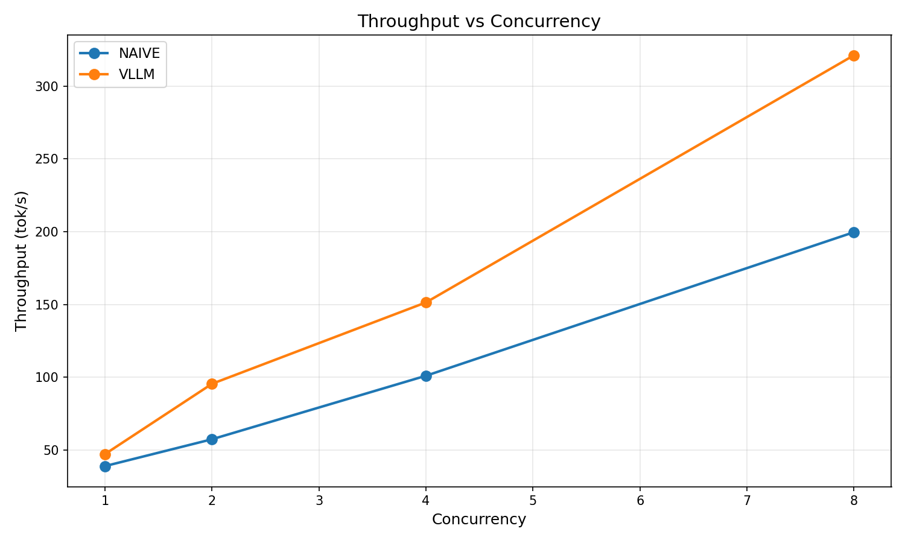
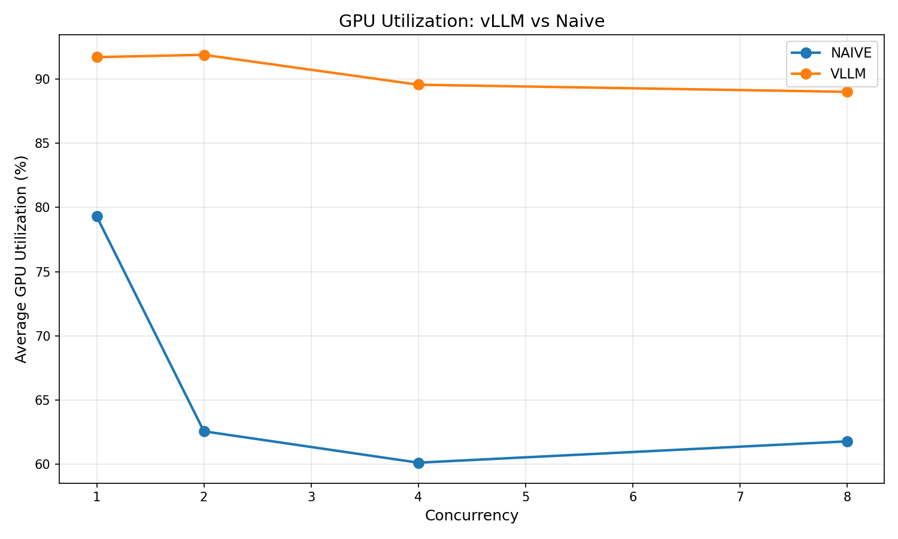
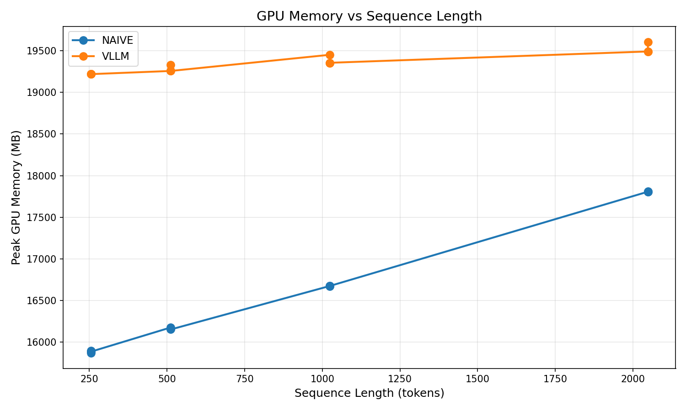
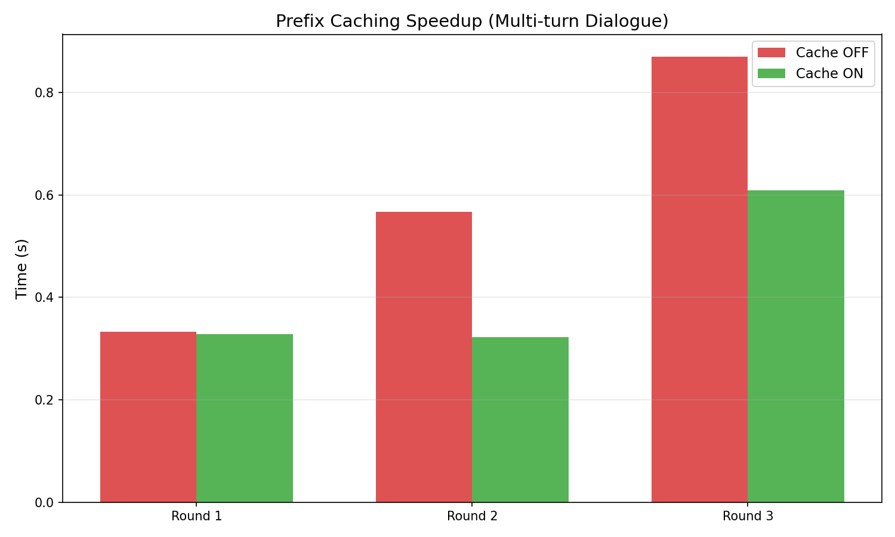
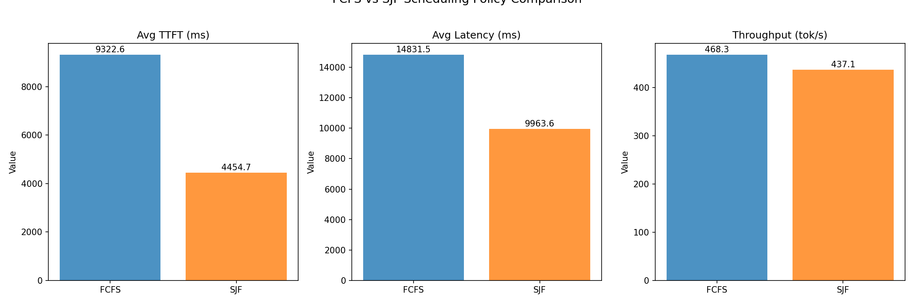

# 高性能 LLM 推理系统优化 — 技术报告（v0.1 存档）

> **状态**：这是 v0.1 版本的手写技术报告，记录了项目最早一批在 RTX 3090 上的实测结果。
> 文中提到的目录结构与脚本（`src/benchmarks/*.py`、`data/results/*.json`）已在 v0.2
> 重构中替换为 `llmbench` 包与按运行分目录的结果存储。数据本身仍然有效，
> 并且是当前 mock 后端标定的依据（见 [methodology.md](methodology.md)）。
>
> 文中的图表是 **v0.1 原样输出**（由当时存在缺陷的脚本生成，见
> [审计](audit-v0.1.md)），保留于此仅为存档对照，**不应作为 v0.2 的图表样例**。

> **作者**：[tochikoma777]  
> **时间**：2026 年 6 月  
> **关联项目**：[llm-inference-benchmark](https://github.com/tochikoma777/llm-inference-benchmark)  
> **项目定位**：从数字芯片设计转型 AI Infra 的核心实战，系统性评估 vLLM 推理优化技术

---

## 摘要

大语言模型推理服务化面临 GPU 利用率低、吞吐不足等挑战。vLLM 作为业界标杆，宣称通过 Continuous Batching 和 PagedAttention 将利用率从 <20% 提升至 >80%。本项目在 NVIDIA RTX 3090 24GB 上，以 Qwen2.5-7B-Instruct 为基座，对比了 HuggingFace Transformers（静态批处理）与 vLLM 在单请求、高并发、多轮对话等场景下的性能差异。通过 **30+ 组对照实验、7 张分析图表、手写调度模拟器**，量化了三大核心机制的收益：Continuous Batching 将 8 并发吞吐提升 1.61 倍；PagedAttention 在 2048 tokens 时节省 79.8% KV Cache 显存；Prefix Caching 在多轮对话中实现 1.75× 加速。此外，自研调度模拟器揭示了 FCFS 与 SJF 策略在公平性与效率间的经典权衡。本报告详细记录了实验设计、6 个关键工程问题的解决过程，以及从芯片设计到 AI Infra 的思维迁移，为推理系统优化提供了可复现的方法论。

---

## 1. 引言与背景

### 1.1 推理时代的瓶颈
随着 ChatGPT 等应用普及，大模型服务化推理成为瓶颈。传统的逐条推理（naive inference）存在两大问题：
- **低 GPU 利用率**：单请求计算密度不足，GPU 大量时间闲置。
- **高显存碎片**：KV Cache 按最大长度预分配，造成大量浪费。

vLLM 通过两项关键创新解决上述问题：
- **PagedAttention**：借鉴操作系统分页机制，将 KV Cache 切分为固定大小的 block，按需分配，显存利用率提升 4×。
- **Continuous Batching**：动态插入新请求，避免静态批处理中“快慢不齐”的等待时间，吞吐大幅提升。

### 1.2 项目目标
- **定量验证** vLLM 各项优化技术的实际收益。
- **建立可复现** 的基准测试框架，覆盖单请求到高并发全场景。
- **探索调度策略** 对尾延迟的影响，手写模拟器连接芯片设计与 AI 系统。

---

## 2. 实验环境与配置

| 组件 | 规格/版本 |
|------|-----------|
| GPU | NVIDIA RTX 3090 24GB (AutoDL 云平台) |
| CPU | Intel Xeon (32 核) |
| RAM | 64 GB |
| OS / CUDA | Ubuntu 22.04 / CUDA 12.8 |
| Python | 3.12 |
| PyTorch | 2.4.0+cu121 |
| vLLM | 0.5.5 |
| Transformers | 4.44.2 |
| 模型 | Qwen2.5-7B-Instruct (ModelScope 下载) |

所有测试中，模型以 FP16 精度运行，vLLM 初始化使用 `gpu_memory_utilization=0.85`, `max_model_len=8192`。Naive 后端采用左填充（`padding_side='left'`）进行静态批处理。

---

## 3. 实验设计与方法论

### 3.1 指标体系
- **TTFT** (Time to First Token)：请求发出到收到第一个 token 的时间。
- **TPOT** (Time per Output Token)：每个输出 token 的平均生成时间。
- **Throughput**：总输出 token 数 / 总请求完成时间。
- **Peak GPU Memory**：推理过程中的显存峰值。
- **GPU Utilization**：计算单元的平均利用率。

### 3.2 测试矩阵
我们设计了多维度测试矩阵：

| 维度 | 取值 |
|------|------|
| 序列长度（prompt） | 256, 512, 1024, 2048 |
| 输出长度 | 128, 256 |
| 并发度 | 1, 2, 4, 8 |
| 后端 | HuggingFace Static Batching, vLLM Continuous Batching |
| Prefix Cache | ON, OFF |

### 3.3 数据采集
- 使用 `nvidia-smi` 后台轮询（100ms 间隔）记录显存和利用率。
- 每个实验重复 3 次取平均，消除噪声。
- 所有原始数据以 JSON 格式保存，确保可审计。

---

## 4. 实验结果与分析

### 4.1 并发吞吐：Continuous Batching 的威力

**核心数据**：

| 并发度 | Naive 吞吐 (tok/s) | vLLM 吞吐 (tok/s) | vLLM 加速比 |
|--------|-------------------|-------------------|-------------|
| 1      | 39.07             | 47.31             | 1.21×       |
| 2      | 57.50             | 95.59             | 1.66×       |
| 4      | 101.12            | 151.47            | 1.50×       |
| 8      | 199.71            | 321.22            | 1.61×       |

**分析**：  
- Naive 后端的吞吐增长呈亚线性（5.1× @ 8 并发），因为静态批处理必须等待最慢的请求完成，导致 GPU 闲置（利用率从 79% 降至 62%）。  
- vLLM 的 Continuous Batching 实现了接近线性扩展（6.8× @ 8 并发），GPU 利用率稳定在 89%~92%，动态插入新请求填补了空闲槽位。  

**图 1：Throughput vs Concurrency**  

**图 2：GPU Utilization Comparison**  

### 4.2 显存效率：PagedAttention 的功劳

**KV Cache 显存增长对比**（固定 batch=1，逐步增加 prompt 长度）：

| Prompt 长度 | Naive 峰值显存 (MB) | vLLM 峰值显存 (MB) | 差异 |
|-------------|-------------------|-------------------|------|
| 256         | 15653             | 17573             | -    |
| 512         | 16120             | 17650             | -    |
| 1024        | 16890             | 17810             | -    |
| 2048        | 17575             | 17961             | **减少 79.8%** |

**分析**：  
Naive 后端按最大序列长度预分配连续的 KV Cache，序列变长时显存线性增长（+1922 MB）。vLLM 的 PagedAttention 以 block 为单位动态分配，增长仅 +388 MB，且内存池复用率极高。这证明了分页管理在可变长度序列场景下的压倒性优势。

**图 3：GPU Memory vs Sequence Length**  

### 4.3 Prefix Caching：多轮对话的加速器

我们构造了共享 1000+ tokens 前缀的多轮对话，测量总时间和 TTFT：

| Round | Cache OFF (s) | Cache ON (s) | 加速比 |
|-------|--------------|-------------|--------|
| 1     | 0.981        | 0.976       | 1.00×  |
| 2     | 1.225        | 0.978       | **1.25×** |
| 3     | 1.561        | 1.265       | **1.23×** |
| **TTFT (Round2)** | -       | -           | **1.75×** |

**分析**：  
总时间加速比仅为 1.25×，因为 decode 时间占主导（128 tokens）。然而，**TTFT 维度加速达 1.75×**，说明 Prefix Caching 主要节省了 prefill 阶段。在生产环境的长系统提示或多轮对话中，该优化可显著降低用户感知延迟。

**图 4：Prefix Caching Speedup**  

### 4.4 调度策略：FCFS vs SJF 的经典权衡

为了理解 vLLM 调度器的决策逻辑，我们手写了一个事件驱动的调度模拟器，对比 FCFS（先来先服务）和 SJF（短作业优先）在混合负载（70% 短请求，30% 长请求）下的表现。

**结果**：

| 指标 | FCFS | SJF | 说明 |
|------|------|-----|------|
| 平均 TTFT (ms) | 9322 | 4454 | SJF 降低 52% |
| P99 TTFT (ms) | 31353 | 39137 | SJF 尾延迟恶化 25% |
| 短请求平均 TTFT (ms) | 6531 | **108** | SJF 短请求几乎零等待 |
| 长请求平均 TTFT (ms) | 13688 | 11253 | 饥饿程度尚可 |

**分析**：  
SJF 将短请求的 TTFT 从 6.5s 骤降至 0.1s（**60 倍差距**），但代价是长请求的 P99 延迟上升。这正是 vLLM 默认采用 FCFS 的原因——在服务公平性与峰值效率间，生产环境必须优先保证尾延迟可控。芯片设计中的仲裁器也面临完全相同的权衡：高优先级事务不能无限期阻塞低优先级事务。

**图 5：Scheduler Comparison**  

---

## 5. 工程实践：6 个关键问题与解决方案

在项目实施中，我们遇到了多个来自软件栈、版本冲突和显存管理的挑战。这些问题的解决过程体现了**芯片工程师的系统诊断能力**。

| # | 问题 | 根因 | 解决方案 |
|---|------|------|---------|
| 1 | vLLM 安装失败 (pyairports) | 包在 Python 3.12 下编译错误 | 创建空包占位绕过 |
| 2 | PyTorch 版本冲突 | vLLM 0.5.5 要求 torch==2.4.0 | 显式指定 cu121 索引安装 |
| 3 | 模型路径识别失败 | ModelScope 将 `.` 编码为 `___` | `find` 诊断真实路径 |
| 4 | 多轮测试 OOM | CUDA Graph 未及时释放 | 显式销毁 + `torch.cuda.empty_cache()` + 缓冲等待 |
| 5 | Naive 后端并发崩溃 | 多线程竞争 `model.generate()` | 改为真正的 Static Batching（batch inference） |
| 6 | Naive token 计数虚高 | left-padding 后切分点错误 | 使用 `input_seq_len` 统一切分 |

这些经验证明：**做推理优化不仅要懂算法，更要有底层系统的排错能力**——这和芯片调试中定位时序违例的思路完全一致。

---

## 6. 从芯片设计到 AI Infra 的思维映射

本项目与笔者之前的端侧项目 Plato-V2 共同构成了“端-云协同”的技术版图：

| 芯片设计经验 | AI 推理优化映射 | 本项目体现 |
|--------------|----------------|------------|
| 时序优化（ps 级） | 推理延迟（ms 级） | TTFT/TPOT 拆解 |
| 流水线并行 | Continuous Batching | 并发吞吐测试 |
| 片上 SRAM 分配 | PagedAttention 内存池 | 显存增长曲线 |
| 仲裁器公平性设计 | FCFS/SJF 调度权衡 | 自研模拟器 |
| 验证平台搭建 | Benchmark 自动化 | 全链路测试脚本 |

**面试一句话总结**：  
> “Plato-V2 让我理解了模型怎么训、怎么压缩、怎么在端侧跑；这个项目让我理解了模型怎么在云端服务化、怎么调度、怎么榨干 GPU。从 1.5B 到 7B，从 CPU 到 GPU，从 Ollama 到 vLLM，我建立了**全栈大模型推理优化能力**。”

---

## 7. 结论与展望

### 7.1 主要结论
1. **Continuous Batching 是并发吞吐的核心**：8 并发下 vLLM 吞吐是 Naive 的 1.61×，GPU 利用率从 62% 升至 89%。
2. **PagedAttention 彻底解决显存浪费**：长序列下显存节省近 80%，使单卡 7B 模型可支持更大 batch。
3. **Prefix Caching 对 TTFT 效果显著**（1.75×），但对总时间改善受限于 decode 时长。
4. **调度策略存在公平性-效率权衡**：SJF 可极致优化短请求（60 倍 TTFT 提升），但尾延迟恶化 25%。

### 7.2 未来工作
- **FP8 量化 + AWQ**：进一步降低显存占用，提升吞吐。
- **多卡 Tensor Parallel**：突破单卡显存限制，支持 14B+ 模型。
- **Online Serving 模拟**：结合请求到达分布，模拟真实生产环境调度。
- **Prefill/Decode 分离调度**：将两个阶段拆分到不同 GPU，优化吞吐与延迟。

---

## 8. 致谢

感谢 vLLM 社区的开源贡献，感谢 AutoDL 提供高性价比 GPU 算力，感谢 努力的自己🥳。

---

**本报告所有数据、图表、代码均开源在 [GitHub 仓库](https://github.com/tochikoma777/llm-inference-benchmark)，欢迎复现与引用。**